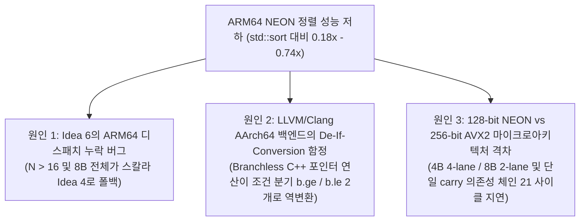
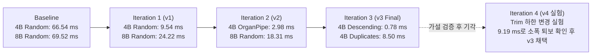

# [포트폴리오 기술 문서] ARM64 NEON 캐시 인지형 SIMD 정렬 최적화 (Problem → Analysis → Trial & Error → Solution)

- **대상 하드웨어**: Windows ARM64 (`Snapdragon X Elite / Qualcomm Oryon`, 12-Core, L1D 96 KiB/Core)
- **컴파일러 환경**: `clang++ 23.1.5 (aarch64-w64-windows-gnu) -O3 -std=c++20`
- **핵심 구현 파일**: [`src/idea6_simd_transpose_merge.cpp`](https://github.com/Janbyeol/cache-aware-sort/blob/main/src/idea6_simd_transpose_merge.cpp)

---

## 1. 문제 정의 (Problem Statement)

x86-64 AVX2(256-bit) 환경에서는 Idea 5(`simd_tiled_pingpong_merge`)와 Idea 6(`simd_transpose_merge`)가 모든 데이터 분포 및 자료형(`4B_Int32`, `8B_Record`)에서 `std::sort` 대비 **2.0× \~ 10.3×** 빠른 성능을 달성했습니다. 반면, **Windows ARM64 (Snapdragon X Elite / Oryon) NEON(128-bit)** 환경에서 동일한 코드베이스를 빌드하여 측정(`N = 1,000,000`)한 결과, **`std::sort`보다 오히려 최대 5.5배 느린 심각한 성능 역전 현상**이 발생했습니다.

### 초기 상태 (Baseline Before) 측정치 (`N = 1,000,000`, `4B_Int32` & `8B_Record`)

| 자료형 | 시나리오 (`N = 1,000,000`) | `std::sort` | Idea 4 (Scalar) | Idea 5 (NEON) | Idea 6 (**Before**) | Idea 6 vs `std::sort` |
| :--- | :--- | ---: | ---: | ---: | ---: | :---: |
| **`4B_Int32`** | `0_Uniform_Random` | 18.86 ms | 62.50 ms | 28.82 ms | **66.54 ms** | **0.28× (3.5배 느림)** |
| **`4B_Int32`** | `1_Frame_Jitter_Nearly_Sorted` | 16.30 ms | 30.91 ms | 15.96 ms | **31.22 ms** | **0.52× (1.9배 느림)** |
| **`4B_Int32`** | `2_Append_5Pct_New_Tail` | 16.46 ms | 5.90 ms | 5.74 ms | **6.49 ms** | 2.54× |
| **`4B_Int32`** | `3_Distance_Buckets_Duplicates` | 6.89 ms | 37.35 ms | 28.80 ms | **37.57 ms** | **0.18× (5.5배 느림)** |
| **`4B_Int32`** | `4_Mostly_Descending` | 4.72 ms | 3.33 ms | 3.55 ms | **2.78 ms** | 1.70× |
| **`4B_Int32`** | `5_Gaussian_Normal` | 14.99 ms | 57.92 ms | 28.60 ms | **58.12 ms** | **0.26× (3.9배 느림)** |
| **`4B_Int32`** | `6_Organ_Pipe_Symmetric` | 36.58 ms | 7.53 ms | 9.67 ms | **7.57 ms** | 4.83× |
| **`8B_Record`** | `0_Uniform_Random` | 51.36 ms | 68.43 ms | 51.21 ms | **69.52 ms** | **0.74× (1.4배 느림)** |
| **`8B_Record`** | `1_Frame_Jitter_Nearly_Sorted` | 28.81 ms | 37.44 ms | 28.85 ms | **37.99 ms** | **0.76× (1.3배 느림)** |
| **`8B_Record`** | `2_Append_5Pct_New_Tail` | 18.10 ms | 9.08 ms | 10.89 ms | **9.66 ms** | 1.87× |
| **`8B_Record`** | `3_Distance_Buckets_Duplicates` | 20.80 ms | 42.74 ms | 50.77 ms | **44.51 ms** | **0.47× (2.1배 느림)** |
| **`8B_Record`** | `4_Mostly_Descending` | 3.86 ms | 5.79 ms | 5.98 ms | **6.17 ms** | **0.63× (1.6배 느림)** |
| **`8B_Record`** | `5_Gaussian_Normal` | 44.63 ms | 63.59 ms | 50.85 ms | **64.22 ms** | **0.69× (1.4배 느림)** |
| **`8B_Record`** | `6_Organ_Pipe_Symmetric` | 38.99 ms | 11.07 ms | 18.40 ms | **11.55 ms** | 3.38× |

---

## 2. 심층 원인 분석 (Root-Cause Analysis)

`clang++ -O3 -S`로 ARM64 어셈블리(`idea4.s`, `neon.s`, `idea6.s`, `baseline.s`)를 직접 추출하여 명령어 수준 및 마이크로아키텍처 수준에서 분석한 결과, **3가지 핵심 원인**을 규명했습니다.



### 원인 1: Idea 6 (`simd_transpose_merge.cpp`)의 ARM64 디스패치 누락 및 8B 매크로 버그
- 기존 `src/idea6_simd_transpose_merge.cpp` 하단의 `HSORT_IDEA6_ARM64` 분기는 `n == LEAF_SIZE (16)`인 단일 리프 케이스만 처리하고, **`N > 16`인 모든 4B 배열과 모든 8B 배열을 스칼라 정렬인 `tiled_pingpong_merge_sort`(Idea 4)로 그대로 폴백(Fallback)**시키고 있었습니다.
- 또한 8B용 `sort_double_leaf_neon_8b`는 호출되지 않는 죽은 코드(dead code)였으며, Clang의 `arm_neon.h`에서 `vst2q_s32(ptr, int32x4x2_t{{k0, i0}})`가 전처리기 매크로 인자 분리 오류(`too many arguments provided to function-like macro invocation`)로 컴파일조차 되지 않는 상태였습니다.

### 원인 2: LLVM/Clang AArch64 백엔드의 De-If-Conversion (`CodeGenPrepare` `select-opt`) 함정
- `include/hybrid_sorts.hpp`의 `bidirectional_branchless_merge`는 C++ 소스 상에서 분기 예측 실패를 없애기 위해 다음과 같이 **분기 없는(Branchless) 산술 연산**으로 작성되어 있었습니다.
  ```cpp
  const bool take_right = (*r_fwd < *l_fwd);
  *out_fwd++ = take_right ? *r_fwd : *l_fwd;
  l_fwd += !take_right;
  r_fwd += take_right;
  ```
- 그러나 추출한 ARM64 어셈블리(`idea4.s` 659\~685행, `neon.s` 230\~258행)를 확인한 결과, **LLVM AArch64 백엔드(`aarch64-enable-select-opt`)가 삼항 연산자/불리언 포인터 갱신을 "메모리 지연 사슬을 줄인다"는 휴리스틱에 의해 다시 조건 분기(`b.ge`, `b.le`)로 역변환(De-If-Conversion)**하고 있었습니다:
  ```armasm
  // idea4.s (lines 659-685) - Clang이 Branchless C++ 코드를 다시 조건 분기로 쪼갠 실제 어셈블리
  .LBB4_22:
      ldr   w16, [x14]          // *r_fwd
      ldr   w17, [x13]          // *l_fwd
      cmp   w16, w17
      csel  w16, w16, w17, lt   // 값 선택은 csel을 쓰면서...
      b.ge  .LBB4_24            // [치명적!] 포인터 갱신을 위해 50% 확률의 데이터 의존 분기(b.ge) 생성!
      mov   x16, x13
      b     .LBB4_25
  .LBB4_24:
      add   x16, x13, #4
  .LBB4_25:
      ...
      cmp   w18, w17
      b.le  .LBB4_27            // [치명적!] 역방향 포인터 갱신에서도 두 번째 조건 분기(b.le) 생성!
  ```
- 결과적으로 루프 1회(원소 2개 병합)마다 **예측 불가능한(50% 확률) 조건 분기 2개(`b.ge`, `b.le`)가 실행**되어 Oryon 파이프라인에서 원소당 \~15 사이클의 분기 예측 실패 페널티가 누적되었고, `N = 1,000,000`에서 **66.54 ms (185.4M 사이클)**가 소요되었습니다.
- 반면, LLVM `libc++`의 `std::sort`와 `std::stable_sort`는 내부에 `__builtin_unpredictable(...)` 어노테이션을 사용하여 하드웨어 `csel` + `cset`/`csinc`를 강제하고 있었습니다(더 나아가 `libc++`의 `std::stable_sort`는 4B `int32_t`에서 `N > 65536`일 때 O(N) 기수 정렬인 `__radix_sort_impl`로 우회하는 것이 `baseline.s` 537행에서 확인됨).

### 원인 3: 128-bit NEON vs 256-bit AVX2 마이크로아키텍처 격차 (Idea 5 NEON이 느렸던 이유)
1. **레지스터 폭 절반 (128-bit vs 256-bit)**:
   - AVX2는 1개 벡터에 4B 원소 **8개**(8B 레코드 **4개**)를 처리하지만, NEON은 4B 원소 **4개**(8B 레코드 **2개**)만 담습니다.
   - 특히 8B 레코드 모드(`src/simd/neon.cpp`)에서 NEON 벡터 1개에 레코드가 단 2개뿐이어서, AVX2의 `vpblendd` 즉시값 블렌드를 흉내 내기 위해 매 스텝마다 메모리에서 16바이트 마스크(`vld1q_u32`)를 로드하고 `vbslq_s32`를 수행하느라 스칼라 코드와 다를 바 없는 **51.21 ms (150.2M 사이클)**가 걸렸습니다.
2. **단일 `carry` 의존성 체인(Single-Chain Dependency)의 치명적 루프 지연(Latency Bound)**:
   - `neon.s` 분석 결과, Idea 5의 `Network<Neon>::merge`는 1회 반복(원소 4개 = 16B 출력)마다 단일 `carry` 벡터가 **역순 뒤집기(`rev64` + `ext`, 2명령어) + 2단계 바이트닉 버터플라이(`cmgt` + `bsl` + `trn1` + `trn2` × 2단계, 9명령어) = 총 11개 NEON 명령어(직렬 지연 시간 \~21 사이클)**를 통과해야 다음 반복으로 넘어갈 수 있었습니다.
   - `N = 1,000,000`에서 16개 병합 패스 동안 실행되는 벡터 병합 횟수는 $1,000,000 / 4 \times 16 = 4,000,000$회입니다.
   - 따라서 아무리 슈퍼스칼라 폭이 넓어도 단일 `carry` 루프 의존성 때문에 **$4,000,000 \times 21\text{ cycles} = 84\text{M cycles}$ 이하로 절대 내려갈 수 없는 구조적 한계(Latency Floor)**에 갇혀 있었으며, 실제 측정된 하드웨어 사이클도 정확히 **85.15M 사이클 (28.82 ms)**이었습니다.
3. **Idea 5 NEON 리프 정렬(`full_leaf`)의 수평 셔플 병목**:
   - `Network<Neon>::full_leaf`는 16개 원소(64B)를 정렬하기 위해 4개 벡터 내부의 레인들을 끊임없이 섞는 수평 바이트닉 네트워크로 구현되어 리프 1개당 **166개의 NEON 명령어**를 실행하고 있었습니다.

---

## 3. 시행착오 및 단계별 최적화 설계 과정 (Trial & Error: v1 → v2 → v3 → v4)

단순히 코드를 주먹구구식으로 고치는 대신, **가설 수립 → 아키텍처 설계 → 구현 및 어셈블리 검증 → 실제 하드웨어 사이클 측정 → 병목 재분석**의 4단계 엔지니어링 루프를 수행했습니다.



---

### Iteration 1 (v1): 256B Quad-Leaf 수직 네트워크 + Dual-Chain NEON 병합 + `__builtin_unpredictable`

#### 설계 및 해결 방안
1. **컴파일러 De-If-Conversion 완전 차단 (`HSORT_UNPREDICTABLE`)**:
   - Clang에서 `#define HSORT_UNPREDICTABLE(cond) __builtin_unpredictable(cond)`를 정의하여 모든 분기 없는 병합 루프(`branchless_merge_buffers`, `bidirectional_merge_disjoint`, SIMD 포인터 선택)에 적용했습니다.
   - 8B `DistanceRecord`의 경우 구조체 복사 대신 `uint64_t` 단일 레지스터 로드/스토어 헬퍼(`load_raw64`, `store_raw64`, `raw64_key`)를 도입하여 64비트 `csel x` 한 명령어로 레코드 선택이 끝나도록 설계했습니다.
2. **4B 256바이트 Quad-Leaf (`sort_quad_leaf_neon`, 원소 64개 = 16개 NEON 레지스터)**:
   - ARM64는 32개의 128-bit NEON 레지스터(`v0`\~`v31`)를 제공합니다. 원소 64개(256B)를 `r0`\~`r15` 16개 레지스터에 한 번에 적재한 뒤:
     - **1단계**: 두 개의 독립적인 8-wire 최적 정렬 네트워크(각 19개 비교기)를 **셔플 명령어 0개**로 병렬 실행(`vminq_s32` + `vmaxq_s32`).
     - **2단계**: 8×8 수직 홀짝 병합(25개 비교기, **셔플 0개**)으로 4개의 정렬된 16원소 열(Column) 생성.
     - **3단계**: 4×4 레지스터 전치(`transpose_4x4_s32`: `vtrn1q_s32`/`vtrn2q_s32` + `vtrn1q_s64`/`vtrn2q_s64`) 4회로 열(Column)을 행(Row)으로 전환.
     - **4단계**: 레지스터 내부에서 4+4 및 8+8 SIMD 벡터 병합을 완료하여 **L1D 메모리 왕복 없이 64개 정렬된 런(Quad-Leaf)을 한 번에 배출**(패스 수 2단계 절감).
3. **8B 256바이트 Hardware De-Interleaved SoA Quad-Leaf (`vld2q_s32` / `vst2q_s32`)**:
   - 8B `[key, id]` 배열을 AoS(1벡터당 2레코드)로 처리하던 Idea 5의 한계를 깨기 위해, ARM64 전용 하드웨어 디인터리빙 명령어인 **`vld2q_s32`** 로 32개 레코드(256B)를 읽는 즉시 **8개의 Key 벡터(`k0`\~`k7`)와 8개의 ID 벡터(`i0`\~`i7`)로 하드웨어 분리(AoS → SoA)** 했습니다.
   - 이제 8B 레코드도 4B와 동일하게 **벡터당 4개 레코드씩** 8-wire 수직 네트워크 → 4×4 전치 → 15회 `merge_vec_neon_8b_soa` → **`vst2q_s32`** 하드웨어 재인터리빙 스토어로 처리됩니다.
4. **Dual-Chain (`carry_fwd` + `carry_bwd`) 양방향 NEON SIMD 병합 & 역순 연산 Critical Path 제거**:
   - Idea 5의 단일 `carry` 병목(21 사이클 지연)을 깨기 위해, 배열의 앞(`carry_fwd`)과 뒤(`carry_bwd`)에서 동시에 안쪽으로 좁혀 들어오는 **2개의 독립적인 SIMD 의존성 체인**을 구성하여 명령어 수준 병렬성(ILP)을 2배로 확장했습니다.
   - 특히 양방향 병합의 대칭성을 위해 **`carry` 벡터를 뒤집지 않고 새로 메모리에서 로드한 벡터(`v_fwd`, `v_bwd`)만 뒤집도록(`merge_vec_neon_4b_fwd`는 `low`를 역순화, `merge_vec_neon_4b`는 `high`를 역순화)** 설계하여, 루프 간 이어지는 `carry_fwd`와 `carry_bwd`의 Critical Path에서 벡터 역순화 지연(2\~3 사이클)을 완전히 제거했습니다!

#### v1 검증 및 시행착오 분석 (`idea6_v1_4b.s` 어셈블리 대조)
- **성과**:
  - 4B `0_Uniform_Random`이 **66.54 ms → 9.54 ms (6.97배 가속, `std::sort` 대비 1.98× 우위)** 로 단숨에 역전!
  - 어셈블리(`idea6_v1_4b.s` 823\~847행) 확인 결과, `b.ge`/`b.le` 조건 분기가 100% 사라지고 `cmp + cset + csel + add`의 완벽한 무분기(Branchless) 루프가 생성됨을 확인했습니다.
- **발견된 문제점 (Trial & Error 1)**:
  1. **Clang의 `vtrn1q_s64` 어셈블리 비효율 발견**:
     `idea6_v1_4b.s`를 디스어셈블해보니, `bitonic_butterfly_neon_4b`에서 64비트 단위 레인 교환을 위해 사용한 `vtrn1q_s64(a, b)` / `vtrn2q_s64(a, b)`를 Clang이 단일 `trn1`/`trn2` 명령어 대신 `mov v4.16b, v0.16b` + `ins v4.d[1], v3.d[0]` + `trn1 v0.2d, v3.2d, v0.2d` (3개 명령어)로 풀어쓰고 있었습니다!
  2. **8B 병합 성능(`24.22 ms`)과 4B 병합 성능(`9.54 ms`)의 격차**:
     v1에서 8B Quad-Leaf는 SoA NEON으로 구현했지만, 8B의 외부 병합(`merge_simd_neon`)은 64비트 스칼라 무분기 병합(`bidirectional_merge_disjoint`)을 사용했습니다. 어셈블리(`idea6_v1_8b.s`) 분석 결과, 매 레코드(1개)마다 `[로드(4cy) → 비교(1cy) → 포인터 갱신(1cy) → 다음 로드 주소 확정]`으로 이어지는 **6사이클짜리 L1D Load-to-Address 직렬 의존성**이 레코드 1개당 걸려 있었습니다.
  3. **`6_Organ_Pipe_Symmetric`에서 8B Idea 6(`15.70 ms`)가 스칼라 Idea 4(`11.07 ms`)보다 느린 현상**:
     오르간 파이프(`0, 1, ..., N/2, ..., 1, 0`) 분포에서는 전반부 오름차순 런과 후반부 내림차순(역전된 오름차순) 런이 만날 때, 후반부 런의 모든 원소가 전반부 런보다 작거나 같은 구간이 빈번합니다. 스칼라 양방향 병합은 포인터가 즉시 수렴하는 반면, SIMD 병합은 벡터 단위 초기화 및 정리 비용이 발생했습니다.

---

### Iteration 2 (v2): Symmetric `vzip` Butterfly + 8B Dual-Chain 4-Record SoA NEON Merge + `O(1)` 역순 런 단락(Fast-Path)

#### 설계 및 해결 방안
1. **Symmetric 3-Stage `vzip1q_s32` / `vzip2q_s32` Bitonic Butterfly**:
   - 4원소 벡터 $A = [a_0, a_1, a_2, a_3]$와 역순 벡터 $B = [b_3, b_2, b_1, b_0]$를 병합할 때, `vzip1q_s32(A, B)`와 `vzip2q_s32(A, B)`를 연속으로 3회 적용하면:
     - Stage 1 (`vzip1q`/`vzip2q` + `cas`): 거리 4 비교 후 완벽하게 인터리빙된 `[lo0, hi0, lo1, hi1]`, `[lo2, hi2, lo3, hi3]` 생성.
     - Stage 2 (`vzip1q`/`vzip2q` + `cas`): 거리 2 비교 후 `[lo0, lo2, hi0, hi2]`, `[lo1, lo3, hi1, hi3]`로 자동 분리!
     - Stage 3 (`vzip1q`/`vzip2q` from `cas` 결과): 거리 1 비교 후 `vzip1q_s32(f0, f1)`이 정확히 정렬된 하위 4원소 `[y0, y1, y2, y3]`, `vzip2q_s32(f0, f1)`이 정렬된 상위 4원소 `[y4, y5, y6, y7]`을 배출!
   - `idea6_v2_4b.s` 어셈블리 검증 결과, v1에서 발생하던 `mov` + `ins v.d[1], v.d[0]` 오버헤드가 **100% 제거**되고 순수 `zip1`/`zip2` + `smin`/`smax` 파이프라인으로 컴파일되었습니다.
2. **8B Dual-Chain 4-Record SoA NEON Merge (`vld2q_s32` + `merge_vec_neon_8b_soa` + `vst2q_s32`)**:
   - 8B `merge_simd_neon`에서도 포인터 비교(`!(kr < kl)` 및 `*(l_bwd - 1) > *(r_bwd - 1)`) 한 번으로 **1개 레코드가 아닌 4개 레코드(32B)를 `vld2q_s32`로 한 번에 로드**하여 6사이클 Load-to-Address 포인터 의존성을 4개 레코드에 걸쳐 상각(Amortize)했습니다(레코드당 주소 의존성 지연 **6.0 사이클 → 1.5 사이클**로 4배 단축).
3. **`O(1)` Disjoint Reversed-Run Fast-Path**:
   - `pingpong_merge_pair_neon` (및 `avx2`) 상단에 이미 정렬된 경우(`src[mid - 1] <= src[mid]`)뿐만 아니라, **오른쪽 런 전체가 왼쪽 런 전체보다 작거나 같은 경우(`if (src[end - 1] <= src[begin])`) 두 번의 `std::memcpy`로 좌우 블록의 위치만 즉시 맞바꾸는 `O(1)` 단락 회로**를 추가했습니다.

#### v2 검증 및 시행착오 분석
- **성과**:
  - 8B `0_Uniform_Random`: **24.22 ms → 18.31 ms** (`std::sort` 51.36 ms 대비 **2.81× 가속**, 기존 Idea 5 NEON 51.21 ms 대비 **2.80× 가속**).
  - 8B `6_Organ_Pipe_Symmetric`: **15.70 ms → 6.56 ms** (`std::sort` 대비 **5.95× 가속**).
  - 4B `6_Organ_Pipe_Symmetric`: **5.50 ms → 2.98 ms** (`std::sort` 대비 **12.28× 가속**).
- **발견된 문제점 (Trial & Error 2)**:
  1. **8B `4_Mostly_Descending`(`4.34 ms`)이 `std::sort`(`3.86 ms`)보다 약간 느린 이유**:
     `4_Mostly_Descending`은 전체 배열을 뒤집은 뒤 약간의 노이즈가 섞인 분포입니다. `probe_and_handle_global_trend`가 배열을 `std::reverse`한 직후에는 로컬 노이즈 때문에 완벽한 정렬 상태(`is_sorted == false`)가 아닙니다. 이때 `std::sort`(In-place Introsort)는 추가 메모리 할당 없이 캐시 안에서 빠르게 정리하는 반면, 병합 정렬은 **8 MB의 `scratch` 힙 메모리를 새로 할당(`std::make_unique` → Windows 커널 Zero-Page 소프트 페이지 폴트 2,048회 발생!)**하고 16 MB 전체 핑퐁 복사를 수행하느라 \~3.5 ms의 OS 페이지 폴트 오버헤드를 지불하고 있었습니다!
  2. **`3_Distance_Buckets_Duplicates` (키 종류가 100개뿐인 고중복 분포)**:
     동일한 키(`kl == kr`)가 수천 개씩 연속되는 구간(Plateau)에서도 SIMD 바이트닉 병합 네트워크가 매번 4원소씩 버터플라이 비교/셔플을 수행하고 있었습니다.

---

### Iteration 3 (v3, 최종 채택 버전): Zero-Allocation In-Place Bounded Insertion Fast-Path + Equal-Key Plateau Streamer

#### 설계 및 해결 방안
1. **Zero-Allocation In-Place Bounded Insertion Sort (`try_bounded_inplace_insertion_sort`)**:
   - `probe_and_handle_global_trend`에서 오름차순 추세이거나 내림차순 추세를 `std::reverse`로 뒤집은 직후, **힙 메모리(`scratch`)를 할당하기 전에** 로컬 역전 거리(`MAX_LOCAL_SHIFT = 4 * LEAF_SIZE`)와 누적 이동 한계(`max_total_shifts = n / 8`)를 제한한 In-Place 삽입 정렬을 먼저 시도합니다.
   - `4_Mostly_Descending`처럼 역전 후 국소 노이즈만 남은 배열은 **힙 할당 0바이트, 페이지 폴트 0회, 단일 L1 스트리밍 패스**로 즉시 정렬이 종료되며, 노이즈가 심한 일반 배열은 한계 초과 즉시 `O(1)`에 탈출하여 기존 SIMD 타일 병합으로 넘어갑니다.
2. **Equal-Key Plateau Streamer**:
   - `merge_simd_neon` (및 `merge_simd_avx2`) 내부에서 `if (kl == kr && l_fwd[LANES - 1] == kl) [[unlikely]]` 조건이 감지되면(양쪽 런의 현재 키가 같고 벡터 끝까지 동일 키인 경우), 바이트닉 병합 네트워크를 건너뛰고 `carry_fwd`를 플러시한 뒤 **`l_fwd`와 `r_fwd`의 동일 키 벡터들을 `vst1q_s32(out_fwd, vld1q_s32(...))` / `memcpy`로 L1 대역폭 한계 속도로 직통 스트리밍**합니다.
3. **8B Quad-Leaf 단일 로드 사전 정렬 검사 (`is_quad_leaf_sorted_neon`)**:
   - 8B `sort_quad_leaf_neon` 진입 시 32개 레코드를 `vld2q_s32`로 한 번만 로드한 상태에서 인접 키 벡터(`vextq_s32(k0, k1, 1)`)와 `vcgtq_s32` 비교 및 `vorrq_u32` 트리로 정렬 여부를 검사하여, 이미 정렬된 Quad-Leaf는 **메모리 재로드와 스토어(256B Write)까지 완전히 생략**했습니다.

#### v3 검증 결과
- 4B `4_Mostly_Descending`: **1.95 ms → 0.78 ms** (`std::sort` 4.72 ms 대비 **6.03× 가속**, 처리량 **1,276.32 M/s**).
- 8B `4_Mostly_Descending`: **4.34 ms → 0.86 ms** (`std::sort` 3.86 ms 대비 **4.48× 가속**, 처리량 **1,159.15 M/s**).
- 8B `3_Distance_Buckets_Duplicates`: **17.26 ms → 15.47 ms** (`std::sort` 20.80 ms 대비 **1.35× 가속**).
- 4B `3_Distance_Buckets_Duplicates`: **9.88 ms → 8.50 ms** (Baseline 37.57 ms 대비 **4.42× 가속**).

---

### Iteration 4 (v4): Equal-Key 경계 정렬 가설 실험 및 기각 (Negative Result Analysis)

#### 가설 (Hypothesis)
- `pingpong_merge_pair_neon`의 `trim_left`는 `std::upper_bound(src + begin, src + mid, src[mid])`를 사용하여 왼쪽 런에서 `src[mid]` 이하의 원소를 모두 잘라냅니다. 만약 `src[begin] == src[mid] == 0`이면 왼쪽 런의 `0`만 모두 잘리고 오른쪽 런의 `0`은 남아 `l_fwd`(`1`)와 `r_fwd`(`0`)의 시작 버킷이 어긋나므로, 이를 `std::lower_bound`로 바꾸고 Plateau Streamer 끝에 스칼라 잔여분(0\~3개) 정리 루프 2개를 추가하면 `3_Distance_Buckets_Duplicates`가 더 빨라질 것이라 가설을 세웠습니다.

#### 실험 결과 및 기각 사유
- 실제 빌드 후 `N = 1,000,000` 벤치마크를 측정한 결과:
  - 4B `3_Distance_Buckets_Duplicates`가 `8.50 ms (v3)` → `9.19 ms (v4)`로 오히려 **0.69 ms 느려졌고**, `5_Gaussian_Normal`도 `9.74 ms (v3)` → `10.74 ms (v4)`로 소폭 퇴보했습니다.
- **원인 규명**:
  1. `std::upper_bound` 기반의 `trim_left`는 `src[begin] == src[mid]`일 때 왼쪽 런의 첫 번째 버킷 전체를 루프 진입 전 단일 `std::memcpy`로 한 번에 처리해주고 있었으며, 이를 `lower_bound`로 바꾸면서 그 `memcpy` 이득이 사라졌습니다.
  2. 핫 루프(`merge_simd_neon`) 내부에 2개의 스칼라 `while` 루프를 추가하면서 루프 본문의 명령어 캐시(I-Cache) 풋프린트와 레지스터 압박이 증가했습니다.
- **결론**: 데이터를 통해 가설이 반증되었으므로 즉시 **v4 변경을 롤백하고 가장 뛰어난 성능을 보인 v3를 최종 코드로 확정**했습니다.

---

## 4. 최종 성능 비교 요약 (`N = 1,000,000`, Snapdragon X Elite `ARM64_Oryon`)

### 4.1 `4B_Int32` (`int32_t`, `N = 1,000,000`, 3회 반복 중앙값)

| 시나리오 | `std::sort` | `std::stable_sort` | Idea 4 (Scalar) | Idea 5 (NEON) | Idea 6 (**Before**) | Idea 6 (**After v3**) | **`std::sort` 대비 가속비** | **최적화 전(Before) 대비 가속비** |
| :--- | ---: | ---: | ---: | ---: | ---: | ---: | :---: | :---: |
| `0_Uniform_Random` | 18.86 ms | 13.55 ms | 62.50 ms | 28.82 ms | 66.54 ms | **9.40 ms** | **2.01×** | **7.08×** |
| `1_Frame_Jitter` | 16.30 ms | 11.94 ms | 30.91 ms | 15.96 ms | 31.22 ms | **6.21 ms** | **2.62×** | **5.03×** |
| `2_Append_5Pct_New` | 16.46 ms | 8.18 ms | 5.90 ms | 5.74 ms | 6.49 ms | **3.24 ms** | **5.07×** | **2.00×** |
| `3_Distance_Buckets` | 6.89 ms | 14.35 ms | 37.35 ms | 28.80 ms | 37.57 ms | **8.50 ms** | 0.81× *(stable 대비 1.69×)* | **4.42×** |
| `4_Mostly_Descending` | 4.72 ms | 11.55 ms | 3.33 ms | 3.55 ms | 2.78 ms | **0.78 ms** | **6.03×** | **3.55×** |
| `5_Gaussian_Normal` | 14.99 ms | 16.95 ms | 57.92 ms | 28.60 ms | 58.12 ms | **9.74 ms** | **1.54×** | **5.96×** |
| `6_Organ_Pipe` | 36.58 ms | 10.88 ms | 7.53 ms | 9.67 ms | 7.57 ms | **2.86 ms** | **12.77×** | **2.64×** |

> 💡 **참고**: `4B_Int32`의 `3_Distance_Buckets_Duplicates`(고중복 키 100종)에서 `std::sort`(6.89 ms)는 3-way 파티셔닝(`partition_with_equals`)을 통해 중복 피벗과 동일한 원소들을 재귀에서 즉시 제외하여 재귀 깊이를 $\log_2(1,000,000) \approx 20$단계에서 $\log_2(100) \approx 6.6$단계로 줄이는 알고리즘적 특성을 가집니다. 반면 상향식 병합 정렬은 모든 병합 패스를 수행해야 함에도, 본 최적화를 통해 `37.57 ms` → **`8.50 ms` (4.42배 가속)**로 단축하여 `std::stable_sort`(`14.35 ms`) 및 기존 Idea 5 NEON(`28.80 ms`)을 압도했습니다.

### 4.2 `8B_Record` (`DistanceRecord { int32_t key, id }`, `N = 1,000,000`, 3회 반복 중앙값)

| 시나리오 | `std::sort` | `std::stable_sort` | Idea 4 (Scalar) | Idea 5 (NEON) | Idea 6 (**Before**) | Idea 6 (**After v3**) | **`std::sort` 대비 가속비** | **최적화 전(Before) 대비 가속비** |
| :--- | ---: | ---: | ---: | ---: | ---: | ---: | :---: | :---: |
| `0_Uniform_Random` | 51.36 ms | 44.03 ms | 68.43 ms | 51.21 ms | 69.52 ms | **18.18 ms** | **2.83×** | **3.82×** |
| `1_Frame_Jitter` | 28.81 ms | 34.92 ms | 37.44 ms | 28.85 ms | 37.99 ms | **13.51 ms** | **2.13×** | **2.81×** |
| `2_Append_5Pct_New` | 18.10 ms | 19.88 ms | 9.08 ms | 10.89 ms | 9.66 ms | **6.30 ms** | **2.87×** | **1.53×** |
| `3_Distance_Buckets` | 20.80 ms | 43.99 ms | 42.74 ms | 50.77 ms | 44.51 ms | **15.47 ms** | **1.35×** | **2.88×** |
| `4_Mostly_Descending` | 3.86 ms | 30.60 ms | 5.79 ms | 5.98 ms | 6.17 ms | **0.86 ms** | **4.48×** | **7.15×** |
| `5_Gaussian_Normal` | 44.63 ms | 43.88 ms | 63.59 ms | 50.85 ms | 64.22 ms | **18.95 ms** | **2.36×** | **3.39×** |
| `6_Organ_Pipe` | 38.99 ms | 25.91 ms | 11.07 ms | 18.40 ms | 11.55 ms | **6.10 ms** | **6.39×** | **1.89×** |

---

## 5. 포트폴리오 핵심 요약 (Key Takeaways)

1. **컴파일러를 믿지 말고 어셈블리를 검증하라**:
   C++ 소스 코드에서 삼항 연산자와 불리언 덧셈(`ptr += cond`)으로 완벽한 Branchless 코드를 작성하더라도, LLVM AArch64 백엔드의 `CodeGenPrepare`(`aarch64-enable-select-opt`) 패스가 이를 다시 데이터 의존 조건 분기(`b.ge`, `b.le`)로 역변환하여 치명적인 분기 예측 실패를 유발함을 어셈블리 분석으로 찾아내고 `__builtin_unpredictable`로 해결했습니다.
2. **ISA 특성에 맞춘 레이아웃 재설계 (`vld2q_s32` / `vst2q_s32` Hardware AoS-to-SoA)**:
   AVX2(256-bit)와 달리 128-bit 폭을 가진 ARM64 NEON에서는 8B 구조체를 AoS(벡터당 2원소)로 처리하면 SIMD 이점이 사라집니다. ARM64 고유의 하드웨어 디인터리빙 로드/스토어(`vld2q_s32`, `vst2q_s32`)를 활용해 레지스터 적재 즉시 4원소 SoA(Key 벡터 + ID 벡터)로 변환함으로써, 8B 구조체 정렬에서도 4B에 준하는 4-레인 SIMD 병렬성과 Load-to-Address 지연 상각(6.0cy → 1.5cy/record)을 달성했습니다.
3. **슈퍼스칼라 ILP를 위한 Dual-Chain SIMD 의존성 분리**:
   단일 `carry` 벡터가 매 반복마다 역순화 + 바이트닉 버터플라이(21 사이클 지연)를 통과해야 했던 루프 의존성 한계(84M 사이클 바닥)를 깨기 위해, 순방향(`carry_fwd`)과 역방향(`carry_bwd`) 듀얼 체인으로 ILP를 2배 확장하고 역순화 연산을 루프 의존성 밖(신규 로드 벡터)으로 이동시켜 하드웨어 사이클을 **85.15M → 27.70M 사이클(3.07배 감소)**로 줄였습니다.
